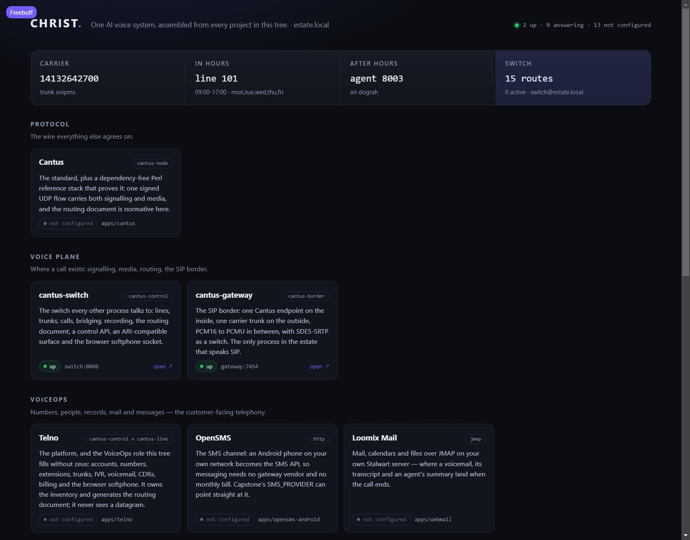

<div align="center">

# ✝ CHRIST

**One AI voice system. Cantus for the call, everything else for what happens on it.**

A working telephone system with an AI receptionist, assembled from every project in
the [Jesus tree](https://github.com/innotelinc/jesus) — and split into containers you
choose, so a box runs only the parts it needs.

[Landing Page](https://innotelinc.github.io/christ/) · [Capabilities](#what-do-you-want-it-to-do) · [Quick start](#quick-start) · [Report an Issue](https://github.com/innotelinc/christ/issues)

</div>

<div align="center">


[](https://github.com/innotelinc/christ/actions/workflows/ci.yml)
[](https://github.com/innotelinc/christ/actions/workflows/conform.yml)
[](https://github.com/innotelinc/christ/actions/workflows/pages.yml)

</div>

> **CHRIST** is the composition root of the [Innotel Platform Stack](https://github.com/innotelinc/innotel-platform-stack):
> one real phone number, one switch, one platform, one AI receptionist, and one page that
> shows all of it while it runs. It does not reimplement the products it integrates — it
> wires them, and it says plainly which of them are containers and which are not.
> **Theme:** Unity · **Style:** the same as [ONYX](https://github.com/innotelinc/freebuff).

---

## The idea

A telephone system is nine programs pretending to be one. A number arrives at a
carrier, a switch decides what it means, a platform owns who it belongs to, an agent
runtime answers it, a model decides what to say, a voice says it, a recording
remembers it, and a console shows it. Every one of those is in this tree already, and
none of them knew about the others.

CHRIST is the part that knows about the others:

```text
   caller ──SIP/RTP──▶ cantus-gateway ──Cantus──▶ cantus-switch ──ARI──▶ dograh ──▶ OmniRoute
                            │                        │  │                    │
                       voip.ms DID                  │  └──/ws/line──▶ softphone
                                                    │
                         telno (numbers, routing document, CDRs, voicemail)
                                                    │
                              CHRIST: the wiring, the board, the souls
```

One switch owns the calls. The platform owns the inventory and generates the routing
document; the switch executes it. The AI does not get a second dial plan — it gets a
route (`{ "ari": { "app": "dograh" } }`) and an extension, like everything else.

## Why CHRIST

| Problem | Answer |
| --- | --- |
| Nine products, nine READMEs, no telephone system. | One declaration of the DID, lines, trunks and agents, applied to the switch and read back. |
| "Do I need all of this to answer one phone?" | A capability catalog: `select voice` is two containers, `select ai` adds the model gateway and names what stays outside. |
| A dial plan is the hardest thing to review in telephony. | It is one JSON document, generated, validated by the switch's own router, and scored offline. |
| AI agents arrive as a second, parallel phone system. | An agent is a route to an ARI app with an extension and a compiled prompt — no second dial plan. |
| A dashboard that can hang up a call will hang up the wrong one. | The board is read-only; wiring is a command with a dry run. |

Its place in the stack is [docs/stack.md](docs/stack.md); the canonical definition of
the shared layers is the
[Innotel Platform Stack](https://github.com/innotelinc/innotel-platform-stack).

## What do you want it to do?

A capability is what you want; a service is a container. You name the first, CHRIST
resolves the second:

```sh
node cli.js select ai
# capabilities: models, voice, agents, memory, tools
# containers:   omniroute, switch, christ
# attached:     Capstone + dograh → set CAPSTONE_URL, DOGRAH_URL
# run: docker compose --profile core --profile models --profile voice ... up -d --build
```

| Capability | Containers | What it buys you |
|---|---|---|
| `voice` | `switch`, `christ` | The floor. Calls, media, routing, the browser softphone, the board. |
| `pstn` | `+ gateway` | A real number, caller ID, and SIP only where it has to exist. |
| `platform` | `+ telno` | Accounts, numbers, IVR, voicemail, CDRs, the softphone, billing. |
| `console` | `+ console` | The operator's window: live calls, lines, the encryption switch. |
| `models` | `+ omniroute` | One OpenAI-compatible endpoint in front of every provider. |
| `agents` | *attached* | Capstone + dograh: the agents, their workflows, their runtime. |
| `memory` | *attached* | claude-mem: what an agent did last time. |
| `mail` | `+ webmail` | Loomix Mail over JMAP: where voicemail and transcripts land. |
| `support` | `+ ontrak` | The graded range and the ticket queue a call escalates into. |
| `messaging` | *attached* | OpenSMS: an Android phone as the SMS API. |
| `tools` | *attached* | REA and ontrak-mcp: MCP tools on stdio. |
| `ai` | *bundle* | All four AI capabilities above, in one word. |

Nothing in the catalog is aspirational. A row that says *attached* means that stack is
its own repository and its own compose file; CHRIST points at it by URL and wires its
numbers, and says so instead of quietly starting half of it.

## Quick start

```sh
git clone https://github.com/innotelinc/jesus.git
cd jesus/christ

cp .env.example .env          # CANTUS_SECRET, CANTUS_CONTROL_TOKEN, carrier credentials
node cli.js select voice pstn platform console
docker compose --profile core --profile voice --profile pstn --profile platform --profile console up -d --build
node cli.js wire              # DID, lines, trunk and the routing document → the switch
node cli.js souls             # souls → out/agents.json
node cli.js up                # the board on :8001
```

No Docker? The voice plane and the board are Node only:

```sh
CANTUS_HTTP_PORT=8288 CANTUS_CONTROL_TOKEN=dev node ../apps/cantus-switch/src/cli.js run &
CANTUS_URL=http://127.0.0.1:8288 CANTUS_CONTROL_TOKEN=dev node cli.js wire
CANTUS_URL=http://127.0.0.1:8288 CANTUS_CONTROL_TOKEN=dev PORT=8001 node server.js
```

Open <http://localhost:8001>. Every project in the tree is on the board, with its role
and its live state; a product that is running is one click away at `/p/<id>/`.

### On a box

`deploy/vultr.sh` creates a fresh instance, installs Docker through cloud-init, uploads
only the directories the selected profiles build — 169 KB, not the tree's 2.8 GB of
history — boots the stack and applies the wiring:

```sh
export VULTR_API_KEY=…                       # or deploy/.vultr-key.env
VOIPMS_SIP_HOST=… VOIPMS_SIP_USERNAME=… VOIPMS_SIP_PASSWORD=… VOIPMS_SIP_FROM_USER=14132642700 \
  ./deploy/vultr.sh up                     # core + pstn + console by default
./deploy/vultr.sh status                   # addresses and the public URLs
./deploy/vultr.sh wire                     # after editing estate.json
VULTR_PROFILES="core pstn platform console" ./deploy/vultr.sh up   # add telno
./deploy/vultr.sh down                     # destroy it
```

Carrier credentials travel in the environment and land in the box's `.env`; they are
never written into the repository, and the deploy's own state (instance id, IP, the
generated signing secret and control token) is git-ignored beside the script.

## The wiring, and why it is a command

`estate.json` is the whole system in one file: the DID, the lines, the trunk, the
agents, and the hours at which a machine answers instead of a person.

```json
{
  "did": "14132642700",
  "trunk": { "name": "voipms", "endpoint": "voipms@gateway", "from": "14132642700" },
  "lines": [{ "ext": "101", "displayName": "Front desk", "numbers": ["14132642700"], "voicemail": true }],
  "agents": [{ "ext": "8003", "name": "Receptionist", "soul": "receptionist.md" }],
  "officeHours": { "weekday": ["mon","tue","wed","thu","fri"], "time": "09:00-17:00", "line": "101" },
  "afterHours": { "agent": "8003" }
}
```

`node cli.js wire` turns that into fifteen routes, three lines and one trunk, validates
the document with **the switch's own `Router`** — not a copy of the schema — posts it,
and then reads it back. A 200 that leaves the old document loaded is a failure, not a
success, because that is the difference that only shows up during the first real call.

The DID is answered three ways, because carriers disagree about what they put in the
request URI: eleven digits, ten, and `+1`. All three ring line 101 in office hours and
hand the call to the receptionist agent outside them.

## Souls: the AI half of the wiring

An agent is not a prompt pasted into a UI. It is a soul — extension, voice, model and
the text it is spoken from — compiled deterministically:

```md
---
ext: 8003
name: Receptionist
voice: piper:en_US-amy-medium
model: omniroute:local
---
# Who you are
You are the receptionist for Innotel, answering the main line outside office hours…
```

`node cli.js souls` compiles every soul in `souls/` into `out/agents.json`: the
extension the dial plan routes, the ARI application that answers it, the voice, and the
prompt. An agent wired to an extension its soul does not declare is an error, and a
soul nobody wired is reported — a prompt that never meets a caller is not an agent.

## The board



`/` is the system, live: the call as one line of topology (carrier → line → agent →
switch), then every project grouped by the layer it belongs to — protocol, voice plane,
VoiceOps, AgentOps, AI, tools — with its role and its real state. Six projects run here,
nine are attached, and the difference is visible rather than implied.

The board is read-only. A board that can hang up a call is a board that can hang up the
wrong one; the wiring is a command with a dry run, not a button.

## Where the code comes from

CHRIST is the composition root of the [Jesus tree](https://github.com/innotelinc/jesus):
it lives at `jesus/christ`, its compose builds the apps from `jesus/apps/<app>`, and its
wiring engine imports `jesus/apps/cantus-switch/src/router.js` so the dial-plan schema
exists once. Cloning it on its own gives you the front door and the docs, and the
`Router` import is the one thing that needs the tree beside it:

```sh
git clone https://github.com/innotelinc/jesus.git
git clone https://github.com/innotelinc/christ.git jesus/christ
cd jesus/christ && node --test test/*.test.js
```

This is deliberate. Re-implementing the routing-document rules here would mean two
schemas that agree until they do not, which is how a dial plan starts rejecting calls
nobody changed.

## What is honest about this

| Claim | Reality |
|---|---|
| "One system" | One switch, one routing document, one DID. The products are still separate processes with separate repositories — that is the point. |
| "AI integrated" | The DID, the agent extensions and the ARI routes are wired, and the prompts are compiled and addressable. Importing `agents.json` into a dograh workflow is a paste today, not an API call: Capstone has no endpoint for it in this tree. |
| "Composable" | Nine services in this compose, each behind a profile. Capstone, dograh, claude-mem, REA, OpenSMS and Soulforge stay outside by design, and the catalog names them instead of pretending. |
| "Works" | The switch suite, the wiring suite and the front-door suite run on every push; `node cli.js wire` was verified against a running switch, 15/15 routes loaded and read back. |

## Layout

| | |
|---|---|
| `system.json` | Every project in the tree, its role and how it plugs in — transcribed from its own README. |
| `estate.json` | The voice system: DID, lines, trunk, agents, hours. |
| `lib/wire.js` | `estate.json` → lines, trunk, routing document; validate, apply, read back. |
| `lib/souls.js` | soul → compiled prompt → `agents.json`. |
| `lib/board.js` | The live board: probes every project, reads the switch. |
| `lib/catalog.js` | A wish → the containers that satisfy it. |
| `server.js` | The front door: board API, plan API, souls API, and one-origin proxy. |
| `souls/` | The agents, authored. |
| `compose.yml` | Nine containers, one profile each. |

## About

Built and maintained by the [Innotel](https://innotel.us) estate — one operator, a
growing set of self-hosted products, and a rule that every one of them has to earn its
container. CHRIST exists because nine good programs that do not know about each other
are not a telephone system, and because "which of these do I actually need?" should be
a question with an answer.

Part of the [Innotel Platform Stack](https://github.com/innotelinc/innotel-platform-stack),
and its role there is recorded in [docs/stack.md](docs/stack.md).

## License

Apache-2.0 for this repository ([LICENSE](LICENSE)). The products it wires keep their
own licences: Cantus and Soulforge are MIT, Telno, Capstone and Loomix are AGPL-3.0,
OpenSMS and claude-mem are Apache-2.0, and the mirrors keep the licences they were
forked under. Read the licence in the directory you are using.
